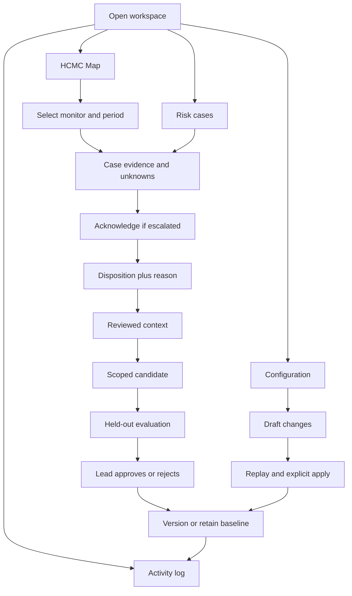

# Product Requirements Document — Cortex Sentinel MVP

[Tiếng Việt](vi/PRD.md) · English

Version: 1.0 · Date: 2026-10-31 · Language: English

Status: implementation-ready proposal. This document specifies target behavior; the current HTML is a prototype, not fulfillment of the backend requirements. See [BRD](BRD.md), [implementation design](Implementation-design.md), and [architecture rationale](Architecture-rationale.md).

## 1. Product contract

Deliver one full alert-to-reviewed-case journey with bounded autonomous investigation and measured, approval-controlled adaptation. Users are risk analysts and risk leads. Data is synthetic. Products are ShopeePay and ShopeePayLater. The map focuses on central/urban HCMC; no world map or relationship lines. Use warm terracotta and neutral colors, with the four existing navigation sections.

**P0:** required for the MVP. **P1:** useful after all P0 gates pass. **P2:** deferred. Do not silently relabel missing P0 requirements as completed.

## 2. Roles

| Operation | Analyst | Risk lead |
|---|---|---|
| View permitted cases/evidence and logs | Yes | Yes |
| Acknowledge/escalate and record disposition | Yes | Yes |
| Create/edit draft or request replay | Yes | Yes |
| Apply configuration/candidate or roll back | No | Yes |
| Pause/resume new investigations | No | Yes |

Use seeded authenticated demo identities backed by a server-side session and role check. A visual role selector alone is not authorization. No production SSO or multi-organization tenancy is required; the sandbox has one organization. Read-only fixture adapters must still constrain entity/time scope.

## 3. Navigation and flows

**F1 — Monitor/investigate:** open seeded map → select configuration/time → choose marker/list row → inspect facts, counter-evidence, source and trace → acknowledge escalation → save disposition with reason. Cases with missing/out-of-area location remain accessible in the case list.

**F2 — Configure:** select existing use case → edit draft → validate → replay exact draft snapshot → inspect failures/metrics → lead applies immutable version. Any edit invalidates prior evaluation. Cancel restores the applied version. New use-case authoring remains in the existing engine.

**F3 — Unattended work:** incoming alert → durable queue → bounded investigation → validation → routing → delivered escalation or explicit retry/failure state. Reopening the UI shows durable results, including work done while the browser was closed.

**F4 — Adapt:** analyst correction → reviewer-eligible context → scoped candidate → frozen holdout replay → lead approves/rejects → activate at new-job boundary → monitor → roll back if needed. No blanket IP allowlist.

## 4. Functional requirements and acceptance criteria

| ID / priority | Requirement | Acceptance criteria |
|---|---|---|
| FR-01 P0 | Engine adapter and synthetic fixtures | Given a valid alert, store its stable ID/time/rule version; duplicate delivery creates no duplicate investigation for the same version. Invalid fields are rejected with reasons. Engine or synthetic adapter identity is visible in run metadata. |
| FR-02 P0 | Four-section UI | Map, Configuration, Risk cases and Activity log navigate independently. Switching sections preserves selected monitor and unsaved drafts within the session. No mandatory wizard. |
| FR-03 P0 | HCMC street map | Show attributed street tiles and case markers only, no network lines/world control. Selecting a monitor fits its valid in-scope markers. Tile error shows retry and never blocks the case list. Preserve pan/zoom during background refresh. |
| FR-04 P0 | Geographic provenance | Every location has source/time and accuracy when known. Missing location stays in list without invented coordinates. Merchant fallback is labeled; external evidence is listed without forcing it onto HCMC map. |
| FR-05 P0 | Filters and list | Map filters monitor plus event-time period; case list defaults to all times for the monitor and visibly says so. Expose linked case details consistently; empty results show guidance. Browser timezone cannot change UTC query boundaries. |
| FR-06 P0 | Configuration lifecycle | Draft fields validate; name is nonblank, distance is an integer 1–100 km, graph depth 2 or 3. Apply requires authorized lead and passing evaluation of the exact draft hash. Server rejects stale versions and analyst apply attempts. |
| FR-07 P0 | Bounded agent investigation | Worker can choose among allowlisted read-only evidence tools. Every invocation records scoped arguments, outcome and budget consumed. At most 8 total tool attempts including retries and 30 seconds per investigation; at most 2 retries per tool. Budget exhaustion routes to Needs review. |
| FR-08 P0 | Grounded output validation | Output references only evidence in the authorized snapshot. Missing fields, unknown evidence IDs, refusal or invalid tool actions are rejected or become Needs review; no case silently clears. Narrative claims are reviewed against cited evidence in evaluation. |
| FR-09 P0 | Case grouping | Related alerts within a configured 20-minute window may share a case when a shared device and merchant overlap exist; shared IP alone never merges cases. New evidence appends to a snapshot version and does not mutate prior findings. Fixture tests cover legitimate shared-IP activity and distinct groups. |
| FR-10 P0 | Routing/escalation | Deterministic router preserves baseline high-risk signals; AI may suggest escalation but cannot downgrade a baseline high-priority case. High priority delivers to internal Risk operations queue; failures/acknowledgment are separate states. Retry does not duplicate delivery. |
| FR-11 P0 | Analyst review | Save Confirmed fraud, Legitimate activity or Insufficient evidence with nonblank reason, actor and timestamp. Original AI assessment remains unchanged. Concurrent stale submission returns conflict instead of overwriting. Insufficient evidence remains open. |
| FR-12 P0 | Feedback and candidate | Only reviewed decisions enter precedent retrieval. Candidate specifies merchant/use-case scope, changed signal, unchanged stronger checks, expiry and parent version. Analyst click alone never changes active routing. |
| FR-13 P0 | Real evaluation and approval | Evaluate candidate and baseline on identical held-out cases and record raw outputs/counts/versions. Critical fixtures must pass; missed fraud cannot increase and false escalations must decrease for candidate activation. Failed/non-improving candidates remain inactive. |
| FR-14 P0 | Rollback | Lead restores a previous immutable policy for new jobs; in-flight jobs finish on their pinned version. Audit records old/new version and reason. Historical case results are not rewritten. |
| FR-15 P0 | Audit and persistence | Alert, run, evidence, disposition, policy and delivery events survive server/browser restart. Record event ID, actor, UTC time, entity, action and versions. UI logs are read-only. |
| FR-16 P0 | Pause/recovery | Pause stops new job claims, not ingestion or existing case review. In-flight jobs finish within budget. Resume drains durable pending work without duplicate effects. Worker crash can retry idempotently. |
| FR-17 P0 | Expiry and escalation SLA | Default acknowledgment deadline is 15 minutes, then one backup escalation to Risk lead with delivery status. Candidate expires after 7 days unless reviewed; expiry uses the guarded restoration procedure in Section 14 for new jobs. Automated tests advance a test clock rather than waiting. |
| FR-18 P1 | Dense map optimization | Cluster markers and query by viewport if fixture size exceeds a declared threshold; preserve an accessible case list. |
| FR-19 P1 | More convenient review | Search cases, export evidence bundles and add richer relationship exploration outside the map. |
| FR-20 P2 | Advanced infrastructure | Trained GNN, feature-store platform, global views, production SSO and external notification channels are deferred. |

## 5. Triage logic and tool contract

The engine supplies baseline signals and priority. High-priority baseline signals cannot be suppressed by model text. A validated suspicious assessment can raise a medium case to high under policy; insufficient evidence always stays open for review. A legitimate assessment only adds a recommendation. Candidate changes must target weak signals while retaining critical device/velocity combinations defined in fixtures.

Tools: `get_case_evidence`, `get_recent_activity`, `expand_relationships`, `get_location_context`, `retrieve_reviewed_cases`. Each accepts scoped entity IDs and bounded time windows, returns typed evidence records or a typed error. No arbitrary SQL, URL fetching or write tool is available to the model. Transaction memos and merchant descriptions are untrusted data, never system instructions.

Output: caseId, assessment enum, supportingEvidenceIds, counterEvidenceIds, missingEvidence, suggestedPriority, suggestedRoute, policyVersion. Assessment values: suspicious, likely_legitimate, insufficient_evidence. Do not expose self-reported model confidence as calibrated fraud probability.

## 6. State model

Keep three separate state machines rather than mixing delivery with fraud determination:

- Investigation: queued → investigating → completed / incomplete. Retry creates a new attempt tied to the same investigation ID and immutable input snapshot.
- Case: open → in_review → resolved_fraud / resolved_legitimate; insufficient evidence remains in_review with an explicit flag. A new linked alert reopens a resolved case only through an explicit auditable event, never by overwriting its disposition.
- Escalation: pending → delivered → acknowledged; delivery failure → retry_pending / failed; delivered and overdue → backup_pending → backup_delivered / failed.
- Policy: draft → evaluated → approved → active → superseded / expired. Rejected candidates never activate. Rollback activates an existing version with a new activation event.

## 7. Data contracts

| Entity | Required fields |
|---|---|
| Transaction | transactionId, occurredAt UTC, product, amountMinor integer, currency VND, accountId, merchantId; optional deviceId/ipRef |
| Alert | alertId, eventTime, ruleId/version, baselinePriority, entityIds, evidenceRefs |
| Case | caseId, configurationId, caseVersion, alertIds, state, priority, createdAt, updatedAt, locationRef |
| Evidence | evidenceId, type, source, observedAt, snapshotId, scoped entity IDs, structured values |
| Location | latitude, longitude, source enum, observedAt, accuracyRadiusKm nullable, evidenceId; no mandatory synthetic fallback |
| Run | runId, attempt, caseId, snapshotId, model/prompt/policy versions, deadline, tool attempts, outcome, latency, usage |
| Decision | decisionId, caseId/version, disposition, reason, actorId, reviewedAt, labelStatus |
| Policy | immutable version, parentVersion, configHash, parameters, approver, approvedAt, activatedAt, expiresAt |
| Evaluation | evalId, datasetHash, split manifest, baseline/candidate versions, per-case expected/observed outcomes, metrics, approval eligibility |
| Outbox/audit | eventId, deduplication key, action, entity, actor, timestamp, delivery/ack status |

Label status distinguishes analyst_suspected, reviewed and adjudicated_fixture. Only the frozen fixture's adjudicated labels determine reported detection metrics. Use a relational database with transactions; graph queries over indexed associations suffice for MVP. Amounts are never summed across currencies without explicit conversion; first release uses VND only.

## 8. API surface (proposed)

- `POST /alerts`: authenticated adapter ingestion with stable alert ID.
- `GET /cases`: configuration/time/bbox/cursor filters, server authorization; detail via `GET /cases/{id}`.
- `POST /cases/{id}/decisions`: version-checked disposition and reason.
- `POST /decisions/{id}/review`: lead-only approval/rejection with reason and expected decision version.
- `POST /escalations/{id}/acknowledgment`: actor and idempotency key.
- `POST /configurations/{id}/drafts`, `POST /evaluations`, `GET /evaluations/{id}`.
- `POST /policies/{version}/activate`, `POST /policies/{version}/rollback`: lead-only, expected active version and reason.
- `POST /investigator/pause` and `/resume`: lead-only.
- `GET /audit`: authorized read, cursor pagination.

Use structured validation errors, 403 for forbidden role, 409 for stale version, and stable job IDs for asynchronous work. Repeated mutation requests with the same idempotency key return the original result. These endpoints are planned, not currently implemented.

## 9. Nonfunctional requirements

- **Reliability:** durable queue or transactional database job table; five consecutive end-to-end fixture runs without lost jobs or duplicate side effects. Failed investigation must leave visible review work.
- **Latency:** 30-second worker deadline, measured end-to-end from claim to routing; queue wait recorded separately. Target local UI feedback under 500 ms excluding network/tiles. Report actual values; no production percentile claim from tiny samples.
- **Cost:** record input/output usage and tool calls per run; configurable run cap and budget stop. Freeze the actual model identifier before evaluation; pricing is not assumed here.
- **Privacy/security:** synthetic-only demo; server-side API credentials; role checks; evidence scope validation; logs omit secrets; tile requests carry no entity IDs. No promise about provider residency/retention without endpoint/account verification.
- **Accessibility:** keyboard-selectable navigation and markers, visible focus, labeled fields, text priority labels, no color-only meaning; list alternative for map; desktop and 320–1600 px layouts without page-level overflow.
- **Maps:** retain attribution and cache policy; no public-tile prefetch or bulk testing. Network outage shows retry/list fallback. Automated tests stub tiles.
- **Retention:** demo database is explicitly resettable using a local development command; no automatic deletion of audit during a run. Production retention is outside scope.

## 10. Evaluation and acceptance dataset

Freeze separate history, development and evaluation manifests with hashes. No connected entity/ring group crosses splits. Point-in-time retrieval may access only records available before the simulated investigation time. Start with at least 20 held-out cases (10 fraud, 10 legitimate) plus 6 critical behavior fixtures; this is a workflow demonstration, not a reliable estimate of population effectiveness.

Critical fixtures: coordinated ring, legitimate shared public IP, missing geolocation, tool timeout, adversarial merchant memo, duplicate alert/delivery. Mark expected outcome for each before running. Timeout/missing evidence must stay in review; public-IP-only activity must not be declared confirmed fraud. Report critical test results separately from detection metrics where labels are not adjudicated.

Compare A rules-only, B rules+fixed evidence bundle, C rules+agent using identical available data, routing constraints and declared budgets. Report fraud recall, false-positive rate, escalation precision, missed fraud, unresolved count, total reviews, latency, tool usage and human review time. Zero denominators are N/A, never zero-percent success. Include unfinished cases explicitly; do not discard them from reports.

Candidate activation requires all critical gates, zero unauthorized actions/fabricated evidence references, no increase in missed fraud and at least one fewer legitimate escalation versus its baseline on the frozen set. If no candidate passes, retain baseline and report the failure honestly. Do not tune repeatedly against the final holdout.

## 11. Implementation order and release gates

| Order | Priority | Build | Dependency | Exit evidence |
|---|---|---|---|---|
| 1 | P0 | Verify engine contract; fixtures, splits, rules baseline, schema | None | Adapter contract and frozen expected outcomes |
| 2 | P0 | Persistence, server roles, case/config APIs, version checks | 1 | Restart, authorization and conflict tests |
| 3 | P0 | Durable job queue, evidence tools, grouping, outbox | 2 | Duplicate/retry/timeout fixtures |
| 4 | P0 | One real agent, validator, deterministic router | 3 | Grounded outputs, budget and adversarial tests |
| 5 | P0 | Connect four-section UI and map to API | 2; final integration needs 4 | Complete alert-to-case workflow; map failure fallback |
| 6 | P0 | Dispositions, precedent eligibility, candidate evaluator | 4–5 | Real baseline/candidate comparison |
| 7 | P0 | Approval, expiry, rollback, backup escalation, audit | 6 | Test-clock and role-boundary checks |
| 8 | P0 | Frozen eval, usability trial, resettable demo and evidence | 1–7 | Release checklist with raw results |
| 9 | P1 | Clustering, search and export | All P0 | Improvement without regression |

If time is insufficient, reduce seeded use-case complexity or remove P1. Keep one real end-to-end agent path and honest evaluation; do not replace it with hardcoded success metrics.

## 12. Release checklist and traceability

- BO-01 → FR-07/08/11 → baseline and timed-review report.
- BO-02 → FR-01/07/10/16/17 → repeated runs, duplicate and failure tests.
- BO-03 → FR-08/10/13 → critical-case results and missed-fraud counts.
- BO-04 → FR-12/13/14 → candidate evaluation, rejection, activation and rollback evidence.
- BO-05 → FR-08/11/15 → inspectable evidence and durable audit.
- BO-06 → FR-02/03/04/05 → map/list/filter/provenance and outage tests.

Release artifacts: commit, fixture/dataset hashes, model/prompt/policy identifiers, test results, raw evaluation output, known failures, startup/reset instructions and demo script. Current UI tests are useful but do not satisfy backend or model gates. No production deployment is authorized by completion of this PRD.

## 13. Open dependencies and chosen defaults

Named owners, actual engine API, final runtime model, team size and schedule remain unconfirmed. Until verified, use a synthetic adapter and state that explicitly. The numeric budgets, fixture counts, grouping window, expiry and escalation SLA above are proposed implementation defaults, not requirements claimed to come from Shopee or competitor research. Product/risk lead should approve changes to these defaults before freezing evaluation.

## 14. Builder-review clarifications (normative)

### Configuration versus adaptation gates

Ordinary configuration apply requires schema validation, all critical behavior fixtures passing, no increased missed fraud versus the currently active policy on the frozen set, and zero unauthorized effects. A name-only change does not have to reduce false escalations. Record unchanged evaluation results for metadata-only changes against the exact draft hash; evaluation may reuse outputs only when the behavior-affecting configuration hash is identical and the reuse is explicitly logged.

Adaptation activation additionally requires at least one fewer false escalation and no increase in missed fraud. This extra gate belongs to FR-13, not every cosmetic configuration edit. A risk-affecting configuration change must execute a fresh replay.

### Reviewed decision eligibility

Analyst saves create analyst_suspected labels, including a disposition titled Confirmed fraud; the title alone does not establish independently confirmed ground truth. A risk lead explicitly approves or rejects retrieval eligibility with a reason and version-checked review event. Approval sets reviewed; rejection retains the original disposition but excludes it from precedent retrieval. Retrieval updates only after the review transaction commits and must enforce reviewed status at query time, even if a search index is stale. Revoke approval to remove eligibility without deleting audit history. Only frozen fixture adjudication establishes evaluation ground truth.

Acceptance: an unreviewed or rejected decision is never returned by retrieve_reviewed_cases; approval makes it eligible only for subsequent investigation snapshots; revocation excludes it from new snapshots. Historical snapshots remain immutable. The demo may use the same person in an explicitly recorded lead role, without claiming independent review.

### Priority floor and candidate scope

Baseline priority means the priority computed by the active approved policy pinned to the run. The model cannot lower it. Candidates may reduce weak shared-IP weighting under the specified merchant/device/timing conditions, but cannot disable the fixed critical combination of shared-device evidence plus coordinated payment timing and merchant overlap in the critical fraud fixture. Altering critical-rule definitions is outside the MVP. Candidate replay recomputes baseline signals under the candidate policy; unchanged critical rules must still pass.

### Safe expiry and rollback

Activation, expiry and rollback atomically compare the expected active version before updating the pointer. If an expiring version is already superseded, log expiry without changing the active pointer. Restore the most recent approved, non-expired ancestor; if none exists, pause new claims and alert the lead rather than activate an invalid version. Never rewrite in-flight pinned versions. Acceptance: activating v3 before v2 expires keeps v3 active; a stale rollback request returns conflict; an expired parent is not restored; concurrent activation events produce a single active version.
