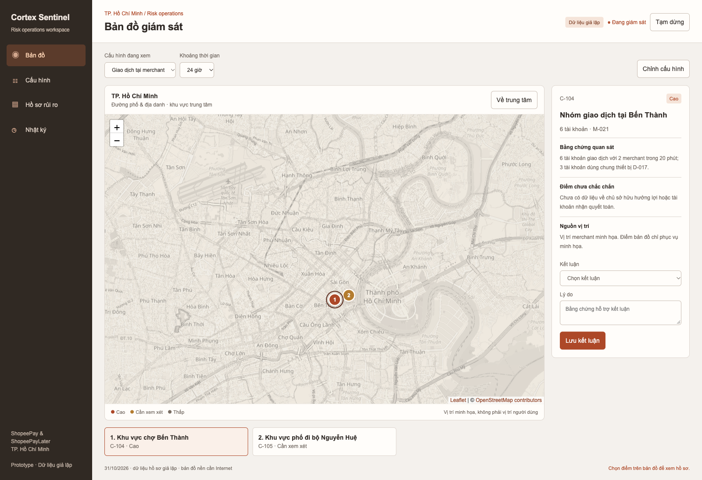

# Cortex Sentinel — TP.HCM

Cập nhật 31/10/2026. Wireframe tập trung vào TP.HCM, bản đồ đường phố chi tiết, không có dây nối, menu dọc và tông cam đất / trung tính.

- [Wireframe tương tác](wireframe.html)
- [Luồng MVP hiện tại](MVP-user-flow.md)
- [Đánh giá tính khả thi](Solution-feasibility-report.md)
- [Thiết kế implementation map và AI triage](Implementation-design.md)
- [Diagram UI/UX, AI triage và use case](../README.md)
- [Kết quả kiểm tra ba vòng](Verification-review.md)
- [Nghiên cứu World Monitor trước đây](World-Monitor-research.md) — tham khảo lịch sử, không còn là bố cục hiện tại.

## Mở demo

Clone/download thư mục PRD, giữ nguyên thư mục `assets`, rồi chạy `python3 -m http.server 8000` trong PRD và mở `http://localhost:8000/wireframe.html`.

Leaflet 1.9.4 được lưu trong `assets` với giấy phép BSD-2-Clause. Bản đồ nền OpenStreetMap cần Internet; attribution hiển thị trực tiếp. Không tải trước hoặc đóng gói dữ liệu tile. Khi tile lỗi, giao diện hiển thị thông báo và nút thử lại; trang Hồ sơ vẫn hoạt động.

## Bốn mục chính

1. **Bản đồ:** chọn cấu hình và khoảng thời gian; xem đường phố TP.HCM, chọn điểm hồ sơ. Không vẽ các đường liên kết.
2. **Cấu hình:** chỉnh tên, sản phẩm, ngưỡng chuyển cấp, độ sâu quan hệ, khoảng cách và nhóm nhận cảnh báo; kiểm tra giả lập rồi áp dụng.
3. **Hồ sơ rủi ro:** xem danh sách đầy đủ của cấu hình, bằng chứng và lưu kết luận; không phụ thuộc tile bản đồ.
4. **Nhật ký:** theo dõi áp dụng cấu hình, quyết định và thao tác agent trong phiên demo.

Thử C-105 để xem vòng phản hồi: đánh dấu Hoạt động hợp lệ, nhập lý do, xem kiểm tra, phê duyệt và hoàn tác.

## Giới hạn

Các điểm hoạt động, hồ sơ và kết quả kiểm tra đều giả lập. Không gọi OpenAI, không có mô hình GNN, không có thực thi thanh toán. Bản nháp được giữ khi chuyển mục trong phiên; tải lại trang sẽ reset. Bản đồ mở ở khu vực trung tâm TP.HCM, không phải bản đồ phân định toàn bộ ranh giới hành chính thành phố. Các điểm không thể hiện vị trí chính xác của người dùng.

## MVP requirements (English)

- [Business Requirements Document](BRD.md)
- [Product Requirements Document](PRD.md)
- [Architecture decisions and justification](Architecture-rationale.md)

These specify target MVP behavior; the current wireframe is not a completed AI backend.

## Tài liệu song ngữ / Bilingual requirements

| Document | English | Tiếng Việt |
|---|---|---|
| BRD | [English](BRD.md) | [Tiếng Việt](vi/BRD.md) |
| PRD | [English](PRD.md) | [Tiếng Việt](vi/PRD.md) |
| Architecture rationale | [English](Architecture-rationale.md) | [Tiếng Việt](vi/Architecture-rationale.md) |
