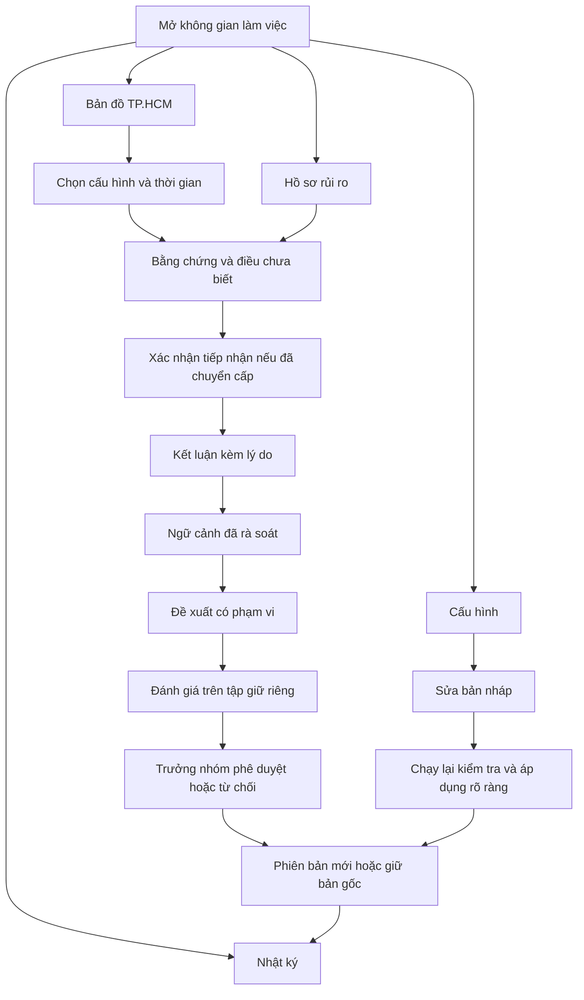

# Tài liệu yêu cầu sản phẩm — Cortex Sentinel MVP

Phiên bản: 1.0 · Ngày: 31/10/2026 · Ngôn ngữ: tiếng Việt. [Bản tiếng Anh](../PRD.md).

Trạng thái: đề xuất đủ chi tiết để triển khai. Tài liệu quy định hành vi mục tiêu; HTML hiện tại là bản mẫu, chưa đáp ứng yêu cầu phía máy chủ. Xem [BRD](BRD.md), [thiết kế triển khai](../Implementation-design.md) và [cơ sở kiến trúc](Architecture-rationale.md). Tên API, trường dữ liệu, giá trị liệt kê và mã trạng thái được giữ nguyên để bảo đảm tương thích kỹ thuật.

## 1. Cam kết sản phẩm

Cung cấp một hành trình đầy đủ từ cảnh báo đến hồ sơ đã xem xét, với điều tra tự chủ có giới hạn và khả năng thích nghi được đo lường, kiểm soát bằng phê duyệt. Người dùng là chuyên viên và trưởng nhóm rủi ro. Dữ liệu giả lập. Sản phẩm gồm ShopeePay và ShopeePayLater. Map tập trung khu vực trung tâm/đô thị TP.HCM; không có bản đồ thế giới hoặc đường nối quan hệ. Sử dụng màu cam đất ấm và trung tính, với bốn mục điều hướng hiện có.

**P0:** bắt buộc cho MVP. **P1:** hữu ích sau khi toàn bộ tiêu chí P0 đạt. **P2:** hoãn. Không âm thầm ghi nhận các yêu cầu P0 còn thiếu là đã hoàn thành.

## 2. Vai trò

| Thao tác | Chuyên viên | Trưởng nhóm rủi ro |
|---|---|---|
| Xem hồ sơ/bằng chứng và nhật ký được phép | Có | Có |
| Xác nhận tiếp nhận/chuyển cấp và ghi kết luận | Có | Có |
| Tạo/sửa bản nháp hoặc yêu cầu chạy lại kiểm tra | Có | Có |
| Áp dụng cấu hình/đề xuất hoặc hoàn tác | Không | Có |
| Tạm dừng/tiếp tục nhận công việc điều tra mới | Không | Có |

Dùng danh tính demo được tạo sẵn, có xác thực bằng phiên phía máy chủ và kiểm tra vai trò. Chỉ có bộ chọn vai trò trên giao diện không phải phân quyền. Không yêu cầu đăng nhập một lần cấp sản xuất hoặc nhiều tổ chức; môi trường thử chỉ có một tổ chức. Bộ chuyển đổi mẫu chỉ đọc vẫn phải giới hạn thực thể/thời gian.

## 3. Điều hướng và luồng

**F1 — Giám sát/điều tra:** mở map tạo sẵn → chọn cấu hình/thời gian → chọn điểm/dòng danh sách → xem sự kiện, phản chứng, nguồn và dấu vết → xác nhận tiếp nhận chuyển cấp → lưu kết luận kèm lý do. Hồ sơ thiếu vị trí hoặc ngoài khu vực vẫn có trong danh sách.

**F2 — Cấu hình:** chọn tình huống hiện có → sửa bản nháp → kiểm tra hợp lệ → chạy lại đúng ảnh chụp bản nháp → xem lỗi/chỉ số → trưởng nhóm áp dụng phiên bản bất biến. Mọi chỉnh sửa làm mất hiệu lực đánh giá trước đó. Hủy khôi phục phiên bản đã áp dụng. Tạo tình huống mới vẫn thuộc bộ máy hiện có.

**F3 — Làm việc không giám sát:** cảnh báo vào → hàng đợi bền vững → điều tra giới hạn → kiểm tra đầu ra → phân tuyến → chuyển cấp đã gửi hoặc trạng thái thử lại/lỗi rõ ràng. Mở lại giao diện thấy kết quả đã lưu, gồm công việc thực hiện khi trình duyệt đóng.

**F4 — Thích nghi:** chuyên viên sửa kết luận → ngữ cảnh đủ điều kiện rà soát → đề xuất có phạm vi → chạy lại tập giữ riêng cố định → trưởng nhóm phê duyệt/từ chối → kích hoạt từ công việc mới → giám sát → hoàn tác nếu cần. Không tạo danh sách IP được bỏ qua vô điều kiện.

## 4. Yêu cầu chức năng và tiêu chí nghiệm thu

| Mã / ưu tiên | Yêu cầu | Tiêu chí nghiệm thu |
|---|---|---|
| FR-01 P0 | Bộ chuyển đổi và mẫu giả lập | Cảnh báo hợp lệ được lưu mã ổn định/thời gian/phiên bản quy tắc; gửi trùng không tạo điều tra trùng cùng phiên bản. Trường sai bị từ chối kèm lý do. Siêu dữ liệu lượt chạy chỉ rõ dùng bộ máy thật hay bộ chuyển đổi giả lập. |
| FR-02 P0 | Giao diện bốn mục | Bản đồ, Cấu hình, Hồ sơ rủi ro và Nhật ký điều hướng riêng. Đổi mục giữ cấu hình được chọn và bản nháp chưa lưu trong phiên. Không bắt buộc trình thiết lập. |
| FR-03 P0 | Bản đồ đường phố TP.HCM | Chỉ có ảnh bản đồ ghi công nguồn và điểm hồ sơ; không đường nối/chế độ thế giới. Chọn cấu hình căn vừa các điểm hợp lệ trong phạm vi. Lỗi map có thử lại, không chặn danh sách. Cập nhật nền giữ khung nhìn/độ phóng. |
| FR-04 P0 | Nguồn gốc vị trí | Mỗi vị trí có nguồn/thời gian và độ chính xác nếu biết. Thiếu vị trí vẫn có trong danh sách, không bịa tọa độ. Nguồn merchant thay thế được ghi nhãn; bằng chứng ngoài khu vực được liệt kê, không ép lên map TP.HCM. |
| FR-05 P0 | Bộ lọc và danh sách | Map lọc cấu hình cùng khoảng thời gian sự kiện; danh sách mặc định mọi thời điểm của cấu hình và ghi rõ. Chi tiết hồ sơ liên kết nhất quán; kết quả trống có hướng dẫn. Múi giờ trình duyệt không thay đổi biên truy vấn UTC. |
| FR-06 P0 | Vòng đời cấu hình | Kiểm tra trường bản nháp: tên không rỗng, khoảng cách nguyên 1–100 km, độ sâu quan hệ 2 hoặc 3. Áp dụng cần trưởng nhóm có quyền và đánh giá đạt đúng mã băm bản nháp. Máy chủ từ chối phiên bản cũ và yêu cầu áp dụng từ chuyên viên. |
| FR-07 P0 | Điều tra có giới hạn | Tiến trình xử lý chọn công cụ bằng chứng chỉ đọc trong danh sách cho phép. Mỗi lần gọi ghi đối số có phạm vi, kết quả và ngân sách tiêu thụ. Tối đa 8 lần gọi tính cả thử lại, 30 giây/cuộc điều tra, tối đa 2 lần thử lại/công cụ. Hết ngân sách chuyển Cần xem xét. |
| FR-08 P0 | Kiểm tra đầu ra có căn cứ | Chỉ tham chiếu bằng chứng trong ảnh chụp được phép. Thiếu trường, mã bằng chứng lạ, mô hình từ chối hoặc hành động công cụ sai phải bị từ chối hoặc chuyển Cần xem xét; không âm thầm coi hồ sơ an toàn. Khi đánh giá, kiểm tra nhận định văn bản với bằng chứng trích dẫn. |
| FR-09 P0 | Gom hồ sơ | Cảnh báo liên quan trong cửa sổ 20 phút có thể chung hồ sơ khi cùng thiết bị và trùng merchant; chỉ chung IP không được gom. Bằng chứng mới bổ sung phiên bản ảnh chụp, không sửa phát hiện cũ. Mẫu thử gồm dùng IP chung hợp lệ và các nhóm độc lập. |
| FR-10 P0 | Phân tuyến/chuyển cấp | Bộ phân tuyến theo quy tắc giữ tín hiệu rủi ro cao gốc; AI được đề nghị chuyển cấp nhưng không hạ hồ sơ vốn ưu tiên cao. Ưu tiên cao gửi hàng đợi Risk operations nội bộ; lỗi/xác nhận tiếp nhận là trạng thái riêng. Thử lại không gửi trùng. |
| FR-11 P0 | Xem xét của chuyên viên | Lưu Xác nhận gian lận, Hoạt động hợp lệ hoặc Chưa đủ bằng chứng kèm lý do không rỗng, người thực hiện, thời gian. Nhận định AI gốc giữ nguyên. Gửi đồng thời trên phiên bản cũ trả xung đột, không ghi đè. Chưa đủ bằng chứng vẫn mở. |
| FR-12 P0 | Phản hồi và đề xuất | Chỉ quyết định đã rà soát mới vào truy xuất tiền lệ. Đề xuất nêu merchant/tình huống, tín hiệu đổi, kiểm tra mạnh hơn giữ nguyên, hạn dùng và phiên bản cha. Một lần nhấn của chuyên viên không tự đổi phân tuyến đang chạy. |
| FR-13 P0 | Đánh giá thật và phê duyệt | Đánh giá đề xuất và phương án gốc trên cùng hồ sơ giữ riêng; lưu đầu ra/số đếm/phiên bản gốc. Mẫu trọng yếu phải đạt; kích hoạt cần không tăng gian lận bỏ sót và giảm chuyển cấp nhầm. Đề xuất lỗi/không cải thiện không kích hoạt. |
| FR-14 P0 | Hoàn tác | Trưởng nhóm khôi phục phiên bản bất biến trước cho công việc mới; việc đang chạy hoàn thành với phiên bản đã gắn. Nhật ký ghi phiên bản cũ/mới và lý do. Không viết lại kết quả lịch sử. |
| FR-15 P0 | Nhật ký và lưu bền vững | Cảnh báo, lượt chạy, bằng chứng, kết luận, chính sách và sự kiện chuyển giao tồn tại sau khởi động lại máy chủ/trình duyệt. Ghi mã sự kiện, người thực hiện, UTC, thực thể, hành động và phiên bản. Nhật ký giao diện chỉ đọc. |
| FR-16 P0 | Tạm dừng/phục hồi | Tạm dừng ngăn nhận công việc mới, không ngăn tiếp nhận dữ liệu hoặc xem hồ sơ. Việc đang chạy kết thúc trong ngân sách. Tiếp tục xử lý việc chờ bền vững không tạo tác động trùng. Sập tiến trình có thể thử lại an toàn, cùng yêu cầu không tạo thêm tác động. |
| FR-17 P0 | Hết hạn và thời hạn chuyển cấp | Mặc định xác nhận tiếp nhận trong 15 phút, sau đó chuyển cấp dự phòng một lần đến trưởng nhóm kèm trạng thái gửi. Đề xuất hết hạn sau 7 ngày nếu chưa được xem xét; áp dụng thủ tục khôi phục có bảo vệ ở Mục 14 cho việc mới. Kiểm thử tự động tiến đồng hồ thử thay vì chờ thực. |
| FR-18 P1 | Tối ưu map nhiều điểm | Gom cụm và truy vấn theo vùng nhìn nếu số mẫu vượt ngưỡng đã công bố; giữ danh sách dễ truy cập. |
| FR-19 P1 | Tiện ích xem xét | Tìm kiếm hồ sơ, xuất bộ bằng chứng, khám phá quan hệ phong phú hơn ngoài map. |
| FR-20 P2 | Hạ tầng nâng cao | Hoãn mạng nơ-ron đồ thị đã huấn luyện, nền tảng kho đặc trưng, map toàn cầu, đăng nhập một lần cấp sản xuất và kênh thông báo ngoài. |

## 5. Logic phân loại/điều phối và hợp đồng công cụ

Bộ máy cung cấp tín hiệu và mức ưu tiên gốc. Văn bản mô hình không được triệt tiêu tín hiệu ưu tiên cao. Nhận định đáng ngờ đã kiểm tra có thể nâng mức trung bình lên cao theo chính sách; thiếu bằng chứng luôn mở để xem xét. Nhận định hợp lệ chỉ thêm khuyến nghị. Đề xuất phải nhắm tín hiệu yếu và giữ tổ hợp thiết bị/tốc độ trọng yếu định nghĩa trong mẫu thử.

Công cụ: `get_case_evidence`, `get_recent_activity`, `expand_relationships`, `get_location_context`, `retrieve_reviewed_cases`. Mỗi công cụ nhận mã thực thể có phạm vi và cửa sổ thời gian giới hạn, trả bản ghi bằng chứng có kiểu hoặc lỗi có kiểu. Mô hình không có SQL tùy ý, công cụ tải URL hoặc công cụ ghi. Ghi chú giao dịch và mô tả merchant là dữ liệu không đáng tin, không phải chỉ dẫn hệ thống.

Đầu ra: caseId, assessment dạng liệt kê, supportingEvidenceIds, counterEvidenceIds, missingEvidence, suggestedPriority, suggestedRoute, policyVersion. Giá trị assessment: suspicious, likely_legitimate, insufficient_evidence. Không hiển thị độ tự tin mô hình tự báo như xác suất gian lận đã hiệu chuẩn.

## 6. Mô hình trạng thái

Giữ ba máy trạng thái vận hành riêng, không trộn chuyển giao với xác định gian lận; chính sách có vòng đời phiên bản riêng:

- Điều tra: queued → investigating → completed / incomplete. Thử lại tạo lần thực hiện mới gắn cùng mã điều tra và ảnh chụp đầu vào bất biến.
- Hồ sơ: open → in_review → resolved_fraud / resolved_legitimate; thiếu bằng chứng vẫn in_review và có cờ rõ ràng. Cảnh báo liên kết mới chỉ mở lại hồ sơ đã xử lý bằng sự kiện kiểm toán rõ ràng, không ghi đè kết luận.
- Chuyển cấp: pending → delivered → acknowledged; gửi lỗi → retry_pending / failed; đã gửi nhưng quá hạn → backup_pending → backup_delivered / failed.
- Chính sách: draft → evaluated → approved → active → superseded / expired. Đề xuất bị từ chối không kích hoạt. Hoàn tác kích hoạt phiên bản có sẵn bằng sự kiện kích hoạt mới.

## 7. Hợp đồng dữ liệu

| Thực thể | Trường bắt buộc |
|---|---|
| Giao dịch | transactionId, occurredAt UTC, product, amountMinor số nguyên, currency VND, accountId, merchantId; deviceId/ipRef tùy chọn |
| Cảnh báo | alertId, eventTime, ruleId/version, baselinePriority, entityIds, evidenceRefs |
| Hồ sơ | caseId, configurationId, caseVersion, alertIds, state, priority, createdAt, updatedAt, locationRef |
| Bằng chứng | evidenceId, type, source, observedAt, snapshotId, mã thực thể trong phạm vi, giá trị có cấu trúc |
| Vị trí | latitude, longitude, source dạng liệt kê, observedAt, accuracyRadiusKm cho phép null, evidenceId; không bắt buộc vị trí giả thay thế |
| Lượt chạy | runId, attempt, caseId, snapshotId, phiên bản model/prompt/policy, deadline, số lần gọi công cụ, kết quả, độ trễ, mức sử dụng |
| Quyết định | decisionId, caseId/version, disposition, reason, actorId, reviewedAt, labelStatus |
| Chính sách | phiên bản bất biến, parentVersion, configHash, parameters, approver, approvedAt, activatedAt, expiresAt |
| Đánh giá | evalId, datasetHash, danh mục chia tập, phiên bản gốc/đề xuất, kết quả mong đợi/quan sát từng hồ sơ, chỉ số, đủ điều kiện phê duyệt hay không |
| Hàng đợi gửi/nhật ký | eventId, khóa chống trùng, action, entity, actor, timestamp, trạng thái gửi/xác nhận |

Trạng thái nhãn phân biệt analyst_suspected, reviewed và adjudicated_fixture. Chỉ nhãn mẫu đã phân xử trong tập cố định quyết định chỉ số phát hiện được báo cáo. Dùng cơ sở dữ liệu quan hệ có giao dịch; truy vấn quan hệ trên liên kết có chỉ mục là đủ cho MVP. Không cộng tiền khác loại tiền nếu chưa chuyển đổi rõ ràng; bản đầu chỉ dùng VND.

## 8. API đề xuất

- `POST /alerts`: tiếp nhận qua bộ chuyển đổi có xác thực với mã cảnh báo ổn định.
- `GET /cases`: lọc cấu hình/thời gian/hộp tọa độ/con trỏ phân trang, phân quyền máy chủ; chi tiết qua `GET /cases/{id}`.
- `POST /cases/{id}/decisions`: kết luận và lý do có kiểm tra phiên bản.
- `POST /decisions/{id}/review`: chỉ trưởng nhóm phê duyệt/từ chối, kèm lý do và phiên bản quyết định kỳ vọng.
- `POST /escalations/{id}/acknowledgment`: người thực hiện và khóa xử lý lặp an toàn.
- `POST /configurations/{id}/drafts`, `POST /evaluations`, `GET /evaluations/{id}`.
- `POST /policies/{version}/activate`, `POST /policies/{version}/rollback`: chỉ trưởng nhóm, phiên bản đang hoạt động kỳ vọng và lý do.
- `POST /investigator/pause` và `/resume`: chỉ trưởng nhóm.
- `GET /audit`: đọc có phân quyền, phân trang bằng con trỏ.

Dùng lỗi kiểm tra có cấu trúc, 403 cho sai quyền, 409 cho phiên bản cũ, mã công việc ổn định cho xử lý bất đồng bộ. Yêu cầu thay đổi lặp với cùng khóa xử lý lặp an toàn trả kết quả ban đầu. Các điểm cuối này mới được đề xuất, chưa triển khai.

## 9. Yêu cầu phi chức năng

- **Độ tin cậy:** hàng đợi bền vững hoặc bảng công việc có giao dịch; năm lần chạy toàn trình liên tiếp không mất việc hoặc tác động trùng. Điều tra lỗi phải để lại việc cần xem xét hiển thị rõ.
- **Độ trễ:** hạn tiến trình 30 giây, đo từ nhận xử lý đến phân tuyến; thời gian chờ hàng đợi ghi riêng. Mục tiêu phản hồi giao diện cục bộ dưới 500 ms, không gồm mạng/map. Báo số thực tế, không suy ra phân vị vận hành từ mẫu nhỏ.
- **Chi phí:** ghi mức sử dụng đầu vào/đầu ra và công cụ từng lượt; giới hạn lượt chạy và dừng theo ngân sách có thể cấu hình. Cố định mã mô hình thật trước đánh giá; không giả định giá tại đây.
- **Riêng tư/an toàn:** demo chỉ dữ liệu giả lập; thông tin xác thực API phía máy chủ; kiểm tra vai trò, phạm vi bằng chứng; nhật ký bỏ bí mật; yêu cầu map không có mã thực thể. Không hứa vị trí lưu/giữ dữ liệu nhà cung cấp khi chưa xác minh điểm cuối/tài khoản.
- **Khả năng tiếp cận:** chọn menu/điểm bằng bàn phím, focus rõ, trường có nhãn, mức ưu tiên bằng chữ, không chỉ dùng màu; danh sách thay thế map; màn hình 320–1600 px không tràn ngang toàn trang.
- **Bản đồ:** giữ ghi công và chính sách bộ nhớ đệm; không tải trước hoặc kiểm thử hàng loạt tile công cộng. Mất mạng có thử lại/danh sách dự phòng. Kiểm thử tự động dùng phản hồi tile giả.
- **Lưu giữ:** cơ sở dữ liệu demo đặt lại bằng lệnh phát triển cục bộ rõ ràng; không tự xóa nhật ký trong lượt chạy. Lưu giữ cấp sản xuất ngoài phạm vi.

## 10. Đánh giá và bộ dữ liệu nghiệm thu

Cố định danh mục lịch sử, phát triển và đánh giá riêng kèm mã băm. Không để cùng nhóm thực thể/đường dây liên quan vượt qua ranh giới tập. Truy xuất theo thời điểm chỉ được dùng bản ghi có trước thời điểm điều tra giả lập. Bắt đầu với ít nhất 20 hồ sơ giữ riêng (10 gian lận, 10 hợp lệ) cộng 6 mẫu hành vi trọng yếu; đây là minh chứng quy trình, không phải ước lượng tin cậy hiệu quả trên quần thể.

Mẫu trọng yếu: nhóm phối hợp, IP công cộng dùng chung hợp lệ, thiếu địa lý, công cụ quá hạn, ghi chú merchant có chỉ dẫn đối kháng, cảnh báo/gửi trùng. Ghi kết quả mong đợi trước chạy. Quá hạn/thiếu bằng chứng phải giữ xem xét; chỉ chung IP công cộng không được kết luận xác nhận gian lận. Báo kết quả trọng yếu riêng khỏi chỉ số phát hiện nếu nhãn chưa được phân xử.

So sánh A chỉ quy tắc, B quy tắc + bộ bằng chứng cố định, C quy tắc + tác tử, dùng cùng dữ liệu được phép, ràng buộc phân tuyến và ngân sách đã công bố. Báo độ bao phủ phát hiện gian lận, tỷ lệ dương tính giả, độ chính xác chuyển cấp, gian lận bỏ sót, số chưa giải quyết, tổng lượt xem xét, độ trễ, mức dùng công cụ và thời gian người xem xét. Mẫu số bằng 0 ghi N/A, không ghi thành công 0%. Nêu rõ hồ sơ chưa hoàn thành, không loại khỏi báo cáo.

Kích hoạt đề xuất cần đạt mọi tiêu chí trọng yếu, không có hành động vượt quyền/tham chiếu bằng chứng bịa, không tăng gian lận bỏ sót và giảm ít nhất một hồ sơ hợp lệ bị chuyển cấp so với phương án gốc trên tập cố định. Không đề xuất nào đạt thì giữ bản gốc, báo thất bại trung thực. Không tối ưu lặp trên tập kiểm tra cuối.

## 11. Thứ tự triển khai và điều kiện chuyển giai đoạn

| Thứ tự | Ưu tiên | Phần xây dựng | Phụ thuộc | Bằng chứng hoàn thành |
|---|---|---|---|---|
| 1 | P0 | Xác minh hợp đồng tích hợp; mẫu, chia tập, quy tắc gốc, lược đồ | Không | Hợp đồng bộ chuyển đổi và kết quả mong đợi cố định |
| 2 | P0 | Lưu bền vững, vai trò máy chủ, API hồ sơ/cấu hình, kiểm tra phiên bản | 1 | Kiểm thử khởi động lại, phân quyền, xung đột |
| 3 | P0 | Hàng đợi bền vững, công cụ bằng chứng, gom nhóm, hàng đợi gửi | 2 | Mẫu trùng/thử lại/quá hạn |
| 4 | P0 | Một tác tử thật, bộ kiểm tra, phân tuyến theo quy tắc | 3 | Đầu ra có căn cứ, kiểm tra ngân sách và đối kháng |
| 5 | P0 | Kết nối bốn mục và map với API | 2; tích hợp cuối cần 4 | Luồng cảnh báo đến hồ sơ đầy đủ; dự phòng lỗi map |
| 6 | P0 | Kết luận, điều kiện tiền lệ, bộ đánh giá đề xuất | 4–5 | So sánh gốc/đề xuất thật |
| 7 | P0 | Phê duyệt, hết hạn, hoàn tác, chuyển cấp dự phòng, nhật ký | 6 | Kiểm tra đồng hồ thử và ranh giới vai trò |
| 8 | P0 | Đánh giá cố định, thử khả dụng, demo đặt lại được và bằng chứng | 1–7 | Danh sách nghiệm thu kèm kết quả gốc |
| 9 | P1 | Gom cụm, tìm kiếm và xuất dữ liệu | Mọi P0 | Cải thiện không gây lỗi hồi quy |

Nếu thiếu thời gian, giảm độ phức tạp tình huống tạo sẵn hoặc bỏ P1. Giữ một luồng tác tử thật xuyên suốt và đánh giá trung thực; không thay bằng số thành công được gán sẵn.

## 12. Danh sách phát hành và liên kết yêu cầu

- BO-01 → FR-07/08/11 → báo cáo phương án gốc và thời gian xem xét.
- BO-02 → FR-01/07/10/16/17 → chạy lặp, kiểm tra trùng và lỗi.
- BO-03 → FR-08/10/13 → kết quả trọng yếu và số gian lận bỏ sót.
- BO-04 → FR-12/13/14 → bằng chứng đánh giá, từ chối, kích hoạt và hoàn tác đề xuất.
- BO-05 → FR-08/11/15 → bằng chứng kiểm tra được và nhật ký bền vững.
- BO-06 → FR-02/03/04/05 → kiểm tra map/danh sách/bộ lọc/nguồn gốc và mất kết nối.

Hiện vật phát hành: mã lần lưu Git, mã băm mẫu/bộ dữ liệu, mã mô hình/chỉ dẫn/chính sách, kết quả kiểm thử, đầu ra đánh giá gốc, lỗi đã biết, hướng dẫn khởi động/đặt lại và kịch bản demo. Kiểm thử UI hiện tại hữu ích nhưng không đáp ứng tiêu chí máy chủ/mô hình. Hoàn thành PRD không cho phép triển khai vận hành thật.

## 13. Phụ thuộc còn mở và mặc định được chọn

Người phụ trách cụ thể, API bộ máy thật, mô hình cuối, quy mô nhóm và lịch chưa được xác nhận. Trước khi xác minh, dùng bộ chuyển đổi giả lập và ghi rõ. Ngân sách, số mẫu, cửa sổ gom nhóm, hạn dùng và thời hạn chuyển cấp ở trên là mặc định triển khai được đề xuất, không phải yêu cầu được cho là từ Shopee hoặc nghiên cứu đối thủ. Sản phẩm/trưởng nhóm rủi ro cần duyệt thay đổi các mặc định trước khi cố định đánh giá.

## 14. Làm rõ sau rà soát khả năng triển khai — có tính quy định

### Điều kiện cấu hình khác điều kiện thích nghi

Áp dụng cấu hình thông thường cần lược đồ hợp lệ, mọi mẫu hành vi trọng yếu đạt, không tăng gian lận bỏ sót so với chính sách đang hoạt động trên tập cố định và không có tác động vượt quyền. Chỉ đổi tên không bắt buộc giảm chuyển cấp nhầm. Ghi kết quả đánh giá không đổi cho thay đổi siêu dữ liệu với đúng mã băm bản nháp; chỉ tái sử dụng đầu ra nếu mã băm phần cấu hình ảnh hưởng hành vi giống hệt và việc tái sử dụng được ghi nhật ký rõ ràng.

Kích hoạt thích nghi còn cần giảm ít nhất một lần chuyển cấp nhầm và không tăng gian lận bỏ sót. Điều kiện thêm thuộc FR-13, không áp cho mọi chỉnh sửa hình thức. Đổi cấu hình ảnh hưởng rủi ro phải chạy lại mới.

### Điều kiện quyết định được dùng làm tiền lệ

Lưu của chuyên viên tạo nhãn analyst_suspected, kể cả kết luận có tên Xác nhận gian lận; tên gọi không tạo sự thật được xác nhận độc lập. Trưởng nhóm phê duyệt/từ chối điều kiện truy xuất rõ ràng, có lý do và sự kiện rà soát kiểm tra phiên bản. Phê duyệt đặt reviewed; từ chối giữ kết luận gốc nhưng loại khỏi truy xuất tiền lệ. Chỉ cập nhật truy xuất sau khi giao dịch rà soát được lưu thành công và phải kiểm tra trạng thái reviewed lúc truy vấn, kể cả chỉ mục tìm kiếm cũ. Thu hồi phê duyệt loại điều kiện sử dụng mà không xóa lịch sử. Chỉ nhãn mẫu cố định đã phân xử mới là sự thật chuẩn để đánh giá.

Nghiệm thu: quyết định chưa rà soát/bị từ chối không bao giờ được `retrieve_reviewed_cases` trả về; phê duyệt chỉ cho phép dùng trong ảnh chụp điều tra tiếp theo; thu hồi loại khỏi ảnh chụp mới. Ảnh chụp lịch sử bất biến. Demo có thể dùng cùng người ở vai trò trưởng nhóm được ghi rõ, không tuyên bố rà soát độc lập.

### Mức ưu tiên sàn và phạm vi đề xuất

Ưu tiên gốc là ưu tiên tính bởi chính sách đang hoạt động đã duyệt và gắn cố định với lượt chạy. Mô hình không được hạ nó. Đề xuất có thể giảm trọng số IP dùng chung yếu theo điều kiện merchant/thiết bị/thời gian đã nêu, nhưng không vô hiệu tổ hợp trọng yếu cố định gồm bằng chứng thiết bị chung, thời điểm thanh toán phối hợp và merchant trùng trong mẫu gian lận trọng yếu. Sửa định nghĩa quy tắc trọng yếu ngoài MVP. Chạy lại đề xuất tính lại tín hiệu gốc theo chính sách đề xuất; các quy tắc trọng yếu không đổi vẫn phải đạt.

### Hết hạn và hoàn tác an toàn

Kích hoạt, hết hạn và hoàn tác so sánh nguyên tử phiên bản đang hoạt động kỳ vọng trước khi đổi tham chiếu. Nếu phiên bản hết hạn đã bị thay thế, ghi sự kiện hết hạn mà không đổi tham chiếu đang hoạt động. Khôi phục phiên bản tổ tiên gần nhất đã duyệt và chưa hết hạn; nếu không có, tạm dừng nhận việc mới và báo trưởng nhóm thay vì kích hoạt bản không hợp lệ. Không viết lại phiên bản đã gắn cho việc đang chạy. Nghiệm thu: kích hoạt v3 trước khi v2 hết hạn vẫn giữ v3; yêu cầu hoàn tác cũ trả xung đột; không khôi phục bản cha đã hết hạn; kích hoạt đồng thời chỉ tạo một phiên bản hoạt động.
