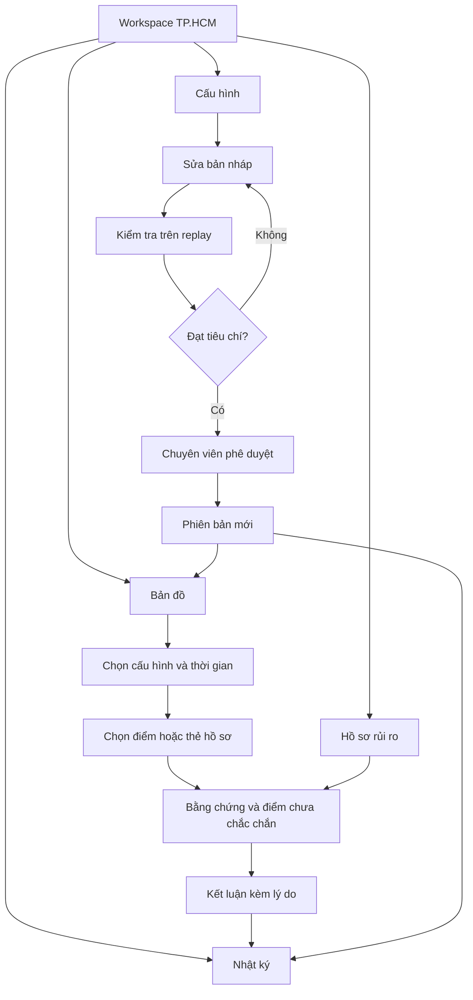
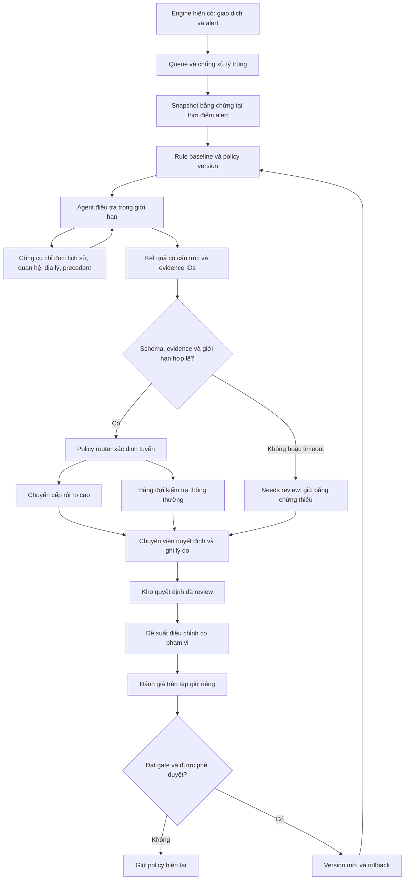

# Cortex Sentinel

AI-assisted fraud triage cho chuyên viên ShopeePay / ShopeePayLater, với bản đồ TP.HCM và các mục Cấu hình, Hồ sơ, Nhật ký.

**Trạng thái:** wireframe tương tác với dữ liệu giả lập. Chưa có runtime AI, đánh giá model thật hoặc tích hợp thanh toán. Các diagram dưới đây mô tả kiến trúc đề xuất, không phải chức năng backend đã triển khai.

- [Wireframe và hướng dẫn chạy](PRD/README.md)
- [Đánh giá tính khả thi và đối chiếu Alipay / WeChat Pay](PRD/Solution-feasibility-report.md)
- [Thiết kế triển khai bản đồ và AI triage](PRD/Implementation-design.md)
- [Luồng MVP](PRD/MVP-user-flow.md)
- [Research nguồn](research/alipay-wechat-bnpl/README.md)


## Diagram UI/UX



## Diagram AI triage



Agent chọn bước điều tra; router thực thi quyền hạn. Model không được tự khóa tài khoản, thay policy hay gửi báo cáo pháp lý. Bằng chứng thiếu luôn dẫn đến review, không phải clearance.

## Use case

| Use case | Người dùng / trigger | Kết quả mong muốn | Bằng chứng cần kiểm tra |
|---|---|---|---|
| UC-01 Giám sát TP.HCM | Analyst chọn cấu hình | Map và hồ sơ đúng phạm vi | Đồng bộ bộ lọc; không dùng tọa độ thiếu |
| UC-02 Điều tra nhóm merchant | Engine phát hiện alert liên quan | Một hồ sơ có bằng chứng và phản chứng | Account/device/merchant liên kết thật trong fixture |
| UC-03 IP dùng chung hợp lệ | Nhiều tài khoản chung IP | Không quy kết chỉ vì chung mạng | Thiết bị, thời gian, precedent và giới hạn địa lý |
| UC-04 Tool lỗi | Enrichment timeout | Hồ sơ incomplete, có retry hữu hạn | Log lỗi và không tự clear |
| UC-05 Đổi cấu hình | Analyst sửa quy tắc | Test trước khi phê duyệt phiên bản | Test invalidation, audit và rollback |
| UC-06 Học từ feedback | Quyết định có lý do | Candidate có phạm vi và đánh giá riêng | False escalation lẫn missed fraud |

## Chạy wireframe

```sh
cd PRD
python3 -m http.server 8000
```

Mở `http://localhost:8000/wireframe.html`. Bản đồ nền cần mạng; dùng HTTP để trình duyệt gửi Referer phù hợp tới tile provider. Không tải hàng loạt tile hoặc dùng public tile server như dịch vụ có SLA. Backend triage trong diagram chưa được xây dựng.
